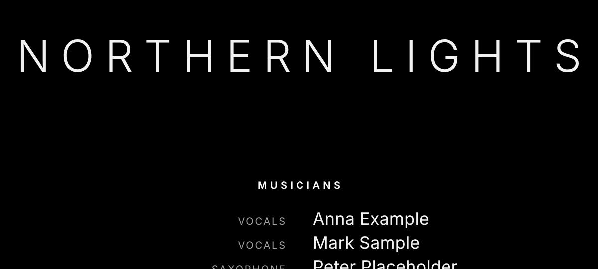
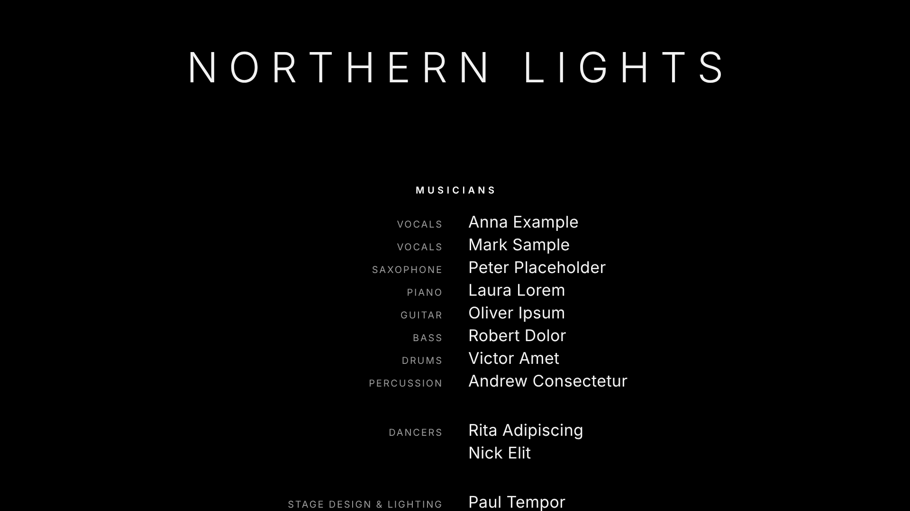
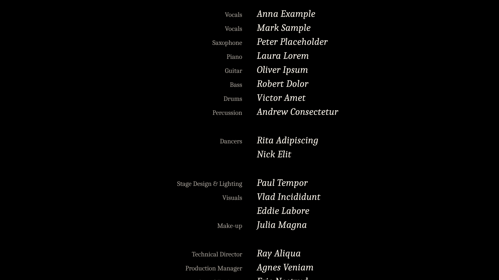
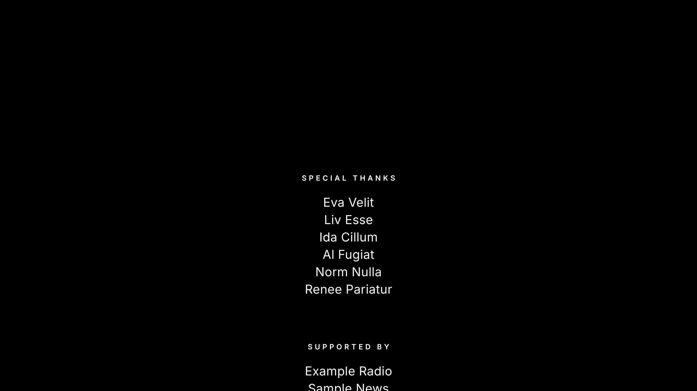
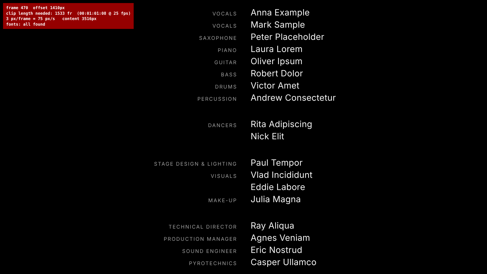

# Rolling OGraf Titles

Film-style **rolling end credits** for **DaVinci Resolve 21**, built as an [EBU OGraf](https://ograf.ebu.io) HTML graphic.

The built-in scrolling titles often judder. Each frame they can move an uneven, fractional number of pixels, so the text shimmers and steps 2-3-2-3. This graphic moves **an exact whole number of output pixels every frame**, the same way film credits are made. Frame *n + 1* is frame *n* shifted up by exactly *N* pixels, with nothing resampled.



*Unscaled crop, 3 px per frame at 25 fps.*

## Examples

| Default look | Serif + italic names |
|---|---|
|  |  |
| **Section headings and centred lists** | **Length helper (turn off for render)** |
|  |  |

*Screenshots are rendered with Inter. In Resolve the default font is Helvetica Neue.*

## Features

- **Integer-pixel motion.** The speed is set in whole pixels per frame, and every line is placed on whole pixels, so there is no sub-pixel shimmer.
- **Simple text markup.** Type or paste the credits straight into the Inspector:
  - `# Title`
  - `## Section`
  - `Role | Name` for two columns
  - `**bold**` and `*italic*`
- **Classic two-column layout.** Roles sit right-aligned against the centre gutter and names sit left-aligned after it, with baselines aligned even when the two columns use different fonts and sizes.
- **Separate styling** for names, roles, section headings and the title: font, size, weight, letter spacing, case and colour.
- **Resolution independent.** All sizes are given as pixels at 1080p and scale to the render height, so UHD works the same way.
- **Two endings.** The credits either roll completely out of frame or stop with the last line centred.
- **Length helper overlay.** It shows how many frames and what timecode the clip must last, and warns if a chosen font is not installed.
- **Transparent background**, ready to lay over picture.
- **Letter-spacing compensation**, so tracked headings and roles stay optically centred and aligned to the column edge.

## Install

1. Download or clone this repository.
2. In DaVinci Resolve 21, import `template/rolling-credits.ograf.json` (keep it next to `rolling-credits.mjs`) into the Media Pool, then drag it onto the timeline.
3. Select the clip and edit everything in **Inspector → OGraf → Properties**.

## Text markup

```
# NORTHERN LIGHTS

## Musicians
Vocals | Anna Example
Guitar | **Oliver Ipsum**

Camera Operators | John Aliquip
 | Ed Commodo

[space 120]

## Special thanks
Eva Velit
Liv Esse
```

| Line | Result |
|---|---|
| `# Text` | Title |
| `## Text` | Section heading (always uppercase) |
| `Role \| Name` | Two-column credit |
| ` \| Name` | Another name under the previous one |
| any other text | Centred line, using the Names style |
| empty line | Gap set by *Empty line gap* |
| `[space 120]` | Exact gap in px (at 1080p) |
| `---` | Half-screen gap |
| `**bold**`, `*italic*` | Inline styling |

## Controls

| Group | Controls |
|---|---|
| Motion | Speed (px per frame), Timeline fps, Ending, Show length + font check |
| Fonts | Main font (list), Main font – other (any installed family name) |
| Names | font, size, weight, italic, colour |
| Roles | font, size, weight, letter spacing, UPPERCASE, colour |
| Sections `##` | size, weight, letter spacing, space before, space after, colour |
| Title `#` | size, weight, letter spacing, space after |
| Layout | Columns – gap, Line spacing, Empty line gap |

**Speed guide:** at 1080p and 25 fps, 2 px/frame is slow, 3 is typical and 4 is brisk. Double the value for UHD. Set *Timeline fps* to match the timeline.

## Tips

- Keep the clip at **Zoom 1.0** with no retime and no motion blur. Any resampling brings the softness back.
- Turn on *Show length + font check*, trim the clip to the length it reports, and turn it off before rendering.
- After updating the template, drag a **fresh** clip onto the timeline. Existing clips keep their old values.

## Notes and limitations

- Resolve 21's Inspector shows only about 35 controls per OGraf graphic. That is why this template has 31, with the most-used controls first.
- The graphic supports both OGraf render modes: real time and non-real time, where the renderer calls `goToTime()` for each frame.
- `tools/verify_pixel_shift.py` renders frames in headless Chrome and checks that each one is an exact *N*-pixel shift of the previous one:

  ```
  pip install playwright pillow numpy
  python3 tools/verify_pixel_shift.py --chrome "/path/to/Google Chrome"
  ```

## License

[MIT](LICENSE)
